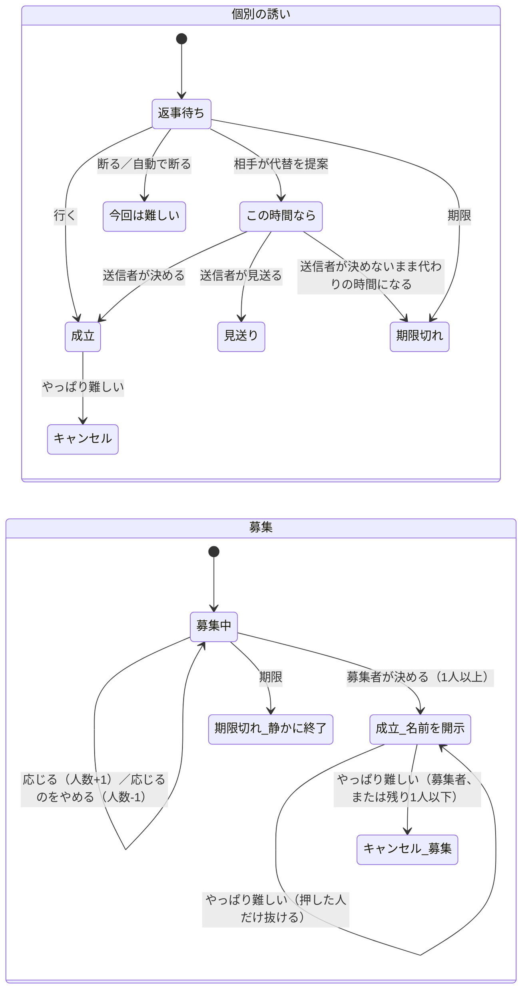
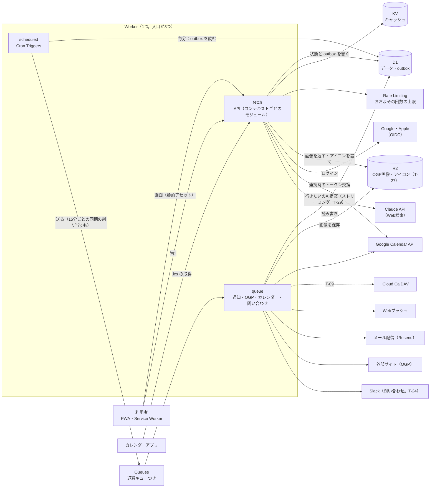

# ここ暇 要求定義書 v0.2

2026-11-23 時点。共同編集の原本はClaude Docsにあり、このファイルはその写しです。

## 概要

「ここ暇」は、友達を誘う気まずさをなくし、会う機会を増やすためのWebサービスです。予定調整の効率化ではなく、誘う側の心理的ハードルを下げることを価値の核に置きます。

| 項目 | 内容 |
| --- | --- |
| 目的 | 誘う気まずさをなくし、会う機会を増やす |
| 価値の核 | 暇がなくても誘える「ここどう？」、角の立たない返答、匿名の募集 |
| 形態 | PWA（Web）先行。アプリ未導入の友達もWebで閲覧・返答できる。ホーム画面に追加する案内は設定に置く（docs/specs/T-25-installable-pwa.md）。ストア公開は需要が出てから |
| 開発の動機 | 開発者自身が使いたいサービスとして作る |
| 収益 | 当面は無料。広告は入れない。将来は企業タイアップを想定 |

## ターゲットと利用シーン

| 項目 | 内容 |
| --- | --- |
| 初期ユーザー | 地元の友達（開発者本人とその周り） |
| 居住エリア | バラバラで混在している |
| カレンダー | GoogleとAppleが混在。カレンダーを使わない人もいる前提 |
| 一番の課題 | 誘うこと自体が気まずい |
| 既存の手段 | LINEグループ。LINEではなくこのサービスを使う理由が必要 |
| 対象外（初期） | 仕事の会議調整、家族の予定共有 |

## 用語定義

| 画面の言葉 | ドメインの名前 | 意味 |
| --- | --- | --- |
| ここ暇 | Availability | 「誘っていい」という許可のサイン。保存は常に時刻の範囲 |
| 時間帯プリセット | Preset | 昼・夕方・夜の入力ショートカット。境界はユーザーが変更可能 |
| くり返し | RecurrenceRule | 毎週の基本暇。実予定が入った日だけ自動で外れる |
| 誘い（個別） | DirectInvite | 1人への提案。枠と重なれば「あそぼ」、重ならなければ「ここどう？」 |
| 募集 | Broadcast | 複数人への「暇な人いる？」 |
| 行く | Accept | 承諾 |
| 今回は難しい | Decline | 理由を持たない断り |
| この時間なら | CounterProposal | 代替の時間の提案 |
| 決める | Decide | 募集の締め。応じた人全員に名前を開示する |
| 成立した予定 | Meetup | 会うことが決まった予定 |
| やっぱり難しい | MeetupCancel ／ MeetupLeave | 成立後の定型のキャンセル。募集の予定では押した人だけが抜ける（MeetupLeave） |
| 見せる／見せない | SharingPolicy | 自分のここ暇を友達ごとに見せるかどうか |
| お知らせ | Notification | アプリの中で読む通知の1件。プッシュとメールは「お知らせがある」ことだけを伝える（docs/specs/T-07-notification.md） |
| 招待リンク | InviteLink | 期限と人数上限つきの友達追加リンク |
| 行きたい | Wish | 行きたい店やしたいことを、日時を決めずに置いておくリスト。友達はそれを見て、その店で誘える（docs/specs/T-22-wishlist.md） |
| 見せない相手（行きたいの） | WishExclusion | その行きたいを見せない友達。行きたいごとに選ぶ。ここ暇の見せる／見せないとは別 |

## 機能要件

| ID | 機能 | 確定した仕様 |
| --- | --- | --- |
| F-01 | 認証 | アカウント登録必須。GoogleとSign in with Apple（メールログインはなし。最初のリリースは Google だけ。T-12）。アカウント連携（設定画面から手動）はMVPの対象外で、GoogleとAppleで別々にログインした人は別の利用者になる（需要が出たらタスクを起こす。#45）。ログインとカレンダー許可は分ける |
| F-02 | カレンダー連携 | Google（OAuth）とApple（CalDAV）。空き／埋まりのみ取得し、予定の中身は取得・保存しない（Google は T-06、Apple CalDAV は T-09） |
| F-03 | ここ暇の設定 | プリセット（昼・夕方・夜）と開始〜終了の両対応。カレンダーの空きを候補表示し、ワンタップで設定 |
| F-04 | 時間帯プリセット | 初期値は昼11〜15時、夕方16〜19時、夜19〜23時。ユーザーが境界を変更できる。変更しても既存の枠は変わらない |
| F-05 | くり返し | 曜日と時間帯で毎週の基本暇を設定。データはルールと例外の2層 |
| F-06 | 自動取り消し | 連携済みの人は、実予定が入ったらここ暇を自動で取り消し、本人に通知 |
| F-07 | 公開範囲 | 友達ごとに見せる／見せないを選択。初期値は「見せる」。見せない相手には「暇がない」と区別できない表示 |
| F-08 | 友達追加 | 期限と人数上限つきの招待リンクを都度発行。開いてログインし、発行者の表示名を見て「友達になる」を1回押すと友達（docs/specs/T-02-friends.md 決定事項8）。表示名がまだない人は、同じ画面で名前を入れて「これで友達になる」を1回押す（docs/specs/T-31-display-name-first-step.md）。友達追加時に通知し、通知から公開をオフにできる |
| F-09 | 友達解除 | 静かに解除（通知なし）。ブロックなし。発行者のリンクを再度開けば友達に戻る |
| F-10 | 個別の誘い | 日時、エリア（任意）、ひとこと、リンク（任意）、期限（送信時に選択） |
| F-11 | 募集 | 応じた人は人数のみ表示。「決める」で応じた人全員へ名前を開示。期限切れは静かに終了し、再募集できる |
| F-12 | 返答 | 行く／今回は難しい／この時間なら。断りは柔らかい定型表現に統一 |
| F-13 | 成立 | GoogleとAppleの双方に自動登録。Apple未連携の人は.icsで保存（Google への登録と .ics は T-06、Apple への登録は T-09） |
| F-14 | 成立後のキャンセル | 定型の「やっぱり難しい」を送るのみ。再調整はしない |
| F-15 | リンクとOGPプレビュー | 誘い・募集・行きたい（F-18）にURLを1件添付。送信時（行きたいは置いたとき）にOGPを取得・保存し、カードで表示。失敗時はドメインのみ |
| F-16 | 通知 | Webプッシュとメール |
| F-17 | 退会 | 直前のログインを求め、すぐに消す（取り消し・猶予なし）。利用者の行は ID だけ残し、本人のデータ（名前・アイコン・ここ暇・友達・連携・お知らせ・書いたひとこと・エリア・リンク・行きたい）を削除（アイコンの画像は1時間で R2 から消す。T-27）。進行中の予定・誘い・募集は本人の「やっぱり難しい」と同じ扱い。相手側の履歴は「退会したユーザー」と表示（docs/specs/T-16-withdrawal.md） |
| F-18 | 行きたいを置く | ひとこと（必須。「〇〇のラーメン行きたい」）、リンク1件（任意。F-15 の OGP カード）、エリア（任意）。期限はなく、本人が消すまで残る。1人が同時に置けるのは10件まで。置いても友達に通知しない（docs/specs/T-22-wishlist.md） |
| F-19 | 行きたいの見える相手 | 友達だけ。行きたいごとに見せない相手を選ぶ（初期値は友達全員で、外す人を選ぶ。あとから友達になった人にも見える。置いたあとでも変えられる）。ここ暇の見せる／見せない（F-07）とは切り離す。外された相手には「何も置いていない」のと区別できない（戻すと外されていたと気づかれうるのは受け入れる。T-22 決めたこと11）。公開範囲は、あとでグループ（Phase 2）を足せる形にする |
| F-20 | 友達の行きたいから誘う | 友達の行きたいから、その友達への個別の誘い（F-10）の作成画面を、ひとこと・リンク・エリアを入れた状態で開く。送られるのは普通の誘いで、行きたいとのつながりは保存しない |
| F-21 | 自分の行きたいから誘う・募集する | 自分の行きたいから、ひとこと・リンク・エリアを入れた状態で、個別の誘い（F-10）か募集（F-11）の作成画面を開く。宛先は自分で選ぶ |
| F-22 | 問い合わせ | ログインした人が設定から、種類（不具合・ご意見・個人情報の開示・削除の請求・その他）を選んで運営に送る。運営者だけの Slack の非公開のチャンネルに届く。1人直近24時間で3件まで、内容は1000文字まで。受け付けたことは画面にだけ出し、自動の返信メールは送らない。プライバシー ポリシーの改定日から使える（docs/specs/T-24-contact.md） |
| F-23 | 行きたいのAI提案 | 行きたいを置くとき、エリアと「何をしたい？」から、AI（Claude）がWebを検索して店や場所の候補を3件まで、選んだ理由とリンクつきで出す。候補のURLは検索の結果にあったものだけ。「行きたいに置く」で置く画面を値を入れた状態で開く（自動では置かない）。AIに渡すのはエリアと言葉だけで、入力と候補はサーバーに残さない。1人1日、候補が出た回は5回・すべての回は10回まで（docs/specs/T-29-wish-suggestion.md） |

## 状態遷移とビジネスルール

誘いは必ず「成立」か「静かに終わる」のどちらかに進み、断りや期限切れで相手に理由が伝わることはありません。

- ここ暇は時刻の範囲で保存し、プリセットは入力のショートカットとして扱う。重なりの判定も時刻で行う。
- 友達に見せるときは「夜 19:00〜23:00」のように時刻を必ず併記する。
- 実予定が入ったここ暇は自動で取り消し、その枠への未返答の誘いは自動で「今回は難しい」を返す。理由は送信者に伝えない。自動で返すのは、受信者のここ暇を取り消しの時点からずっと見られた送信者の誘いだけ（「見せない」にした相手などの誘いは返事待ちのまま期限で切れ、ここ暇がなかったときと同じに見える。docs/specs/T-06-calendar.md 決定事項15）。
- 予定が成立しても、参加者のここ暇は取り消さず、友達に見せたままにする（MVPでは受け入れる）。同じ時間に別の誘いが届いたり、別の誘いに「行く」と返したりすることも止めない。成立した予定は「ここ暇」カレンダーに書くので、カレンダーの自動取り消しの対象にもならない（確認するのは `primary` だけ）。人が自分で取り消す。成立と重なるここ暇の自動取り消しは、需要が出たら小さなタスクとして起こす（docs/roadmap.md の「あとで」。#39）。
- くり返しの枠は、ルールから生成し、実予定で外れた日は例外として扱う。
- 友達関係は、招待リンクの発行者と、開いてログインした人の間に成立する。解除は相手に通知しない。

## 非機能要件とアーキテクチャ

- API・定期処理（Cron）・Queue の処理は、1つの Worker の3つの入口（fetch・scheduled・queue）として動く（`apps/api/src/worker.ts`）。
- 外部連携は queue の処理から行う。API が外部を呼ぶのは、ログインのトークン交換と鍵の取得、カレンダー連携のときのトークン交換と取り消し、本人がその場で待つ読み取り（カレンダーの空きの候補。T-06 決定事項11。行きたいのAI提案。T-29）だけ。
- Cron は outbox の未処理の行を Queues に送り、期限切れのデータを消す。15分ごとのカレンダーの確認も Queue を経由する。
- iCloud CalDAV は T-09 で対応する（点線）。

| ID | 要件 |
| --- | --- |
| NF-01 | バックエンドはCloudflare Workersを基盤とし、D1・KV・R2・Queues・Cron・Rate Limitingで構成する |
| NF-02 | 外部連携（通知、OGP、カレンダー書き込み）はQueues経由の非同期処理とし、失敗時は再試行する |
| NF-03 | 状態更新とイベントの受け渡しはOutboxパターンで行い、状態遷移は条件付き更新で二重処理を防ぐ |
| NF-04 | 認証情報はSecretsの鍵でアプリ側暗号化して保存する |
| NF-05 | ドメイン層はCloudflareに依存しないTypeScriptで書き、単体テストで検証する |
| NF-06 | カレンダー連携はプロバイダを抽象化し、Google・Apple・将来のOutlookを差し替え可能にする |
| NF-07 | 通知は1日の上限とユーザーごとの停止設定を持ち、自動取り消しはまとめて通知する |
| NF-08 | 個人が特定されない集計で、ユーザー数・成立数・エリア分布を計測する（成立の記録は今は残さない。終わった予定は30日で消えるので、過去の成立は後から数えられない。集計は #46 で決める。T-17） |
| NF-09 | 無料プランのCPU時間制限を踏まえ、有料プランを前提とする（最新の上限は公式で確認） |
| NF-10 | Apple CalDAVのWorkersからの接続性を、実装着手前に検証する |

## 技術選定

Cloudflare Workersを基盤に、フロントとAPIで型と入力検証のスキーマを共有するpnpmのモノレポで構成します。

| 領域 | 選定 | 理由 |
| --- | --- | --- |
| APIフレームワーク | Hono | Workers向けで軽く、認証をミドルウェアで挟みやすい |
| フロントエンド | React＋Vite（PWA） | 実装LLMが最も正確に書ける |
| スタイル | Tailwind CSS＋デザイントークン | トークンをそのまま設定に落とせる |
| データ取得 | TanStack Query | キャッシュと重複排除、返答などの楽観的更新が書きやすい |
| 入力検証 | Zod | APIとフロントでスキーマと型を共有できる |
| DBアクセス | Drizzle ORM（D1） | 型安全で、認可条件をSQLに明示しやすい |
| テスト | 単体：Vitest＋Cloudflareのworkers向けプール、E2E：Playwright | 単体はD1込みの本物に近い環境で、E2Eは利用者の流れを実ブラウザで確かめる |
| JWT・暗号 | jose（WebCrypto） | Workersで動く定番。暗号処理は自作しない |
| メール配信 | Resend をAPIで利用（docs/specs/T-07-notification.md） | Cloudflareのメール機能は任意宛先の通知向きではない |
| AI | Claude API（`claude-haiku-5-5`、Web検索のツール）を公式の SDK（`@anthropic-ai/sdk`）で利用（docs/specs/T-29-wish-suggestion.md） | 実在の店のURLを出すには検索が要る（Workers AI は検索を持たない）。料金を抑えるため Haiku から始める |
| Webプッシュ | Workers（WebCrypto）で動く実装 | Node向けのライブラリはそのまま動かないことがある |
| パッケージ管理 | pnpmのモノレポ（apps/web、apps/api、packages/shared） | 型とスキーマを1か所で管理する |
| CI | GitHub Actions＋依存更新の自動プルリクエスト | 更新を日単位で回す運用に必要 |
| 監視 | Workers Logs＋Monitors・Workers Issues（Slack に通知）＋外からの死活監視（Better Stack）。利用料アラートは #42 | 異常検知と、利用料の急増への備え（条件と通知先は docs/specs/T-13-monitoring.md、手順は docs/runbooks/monitoring.md） |
| IaC | 暫定：Terraform（Cloudflareプロバイダv5）＋wrangler。Alchemyとの比較検証（T-00）で確定する。決定は `docs/decisions/0001-iac-tool.md` | 最初からコードで管理し、セキュリティ設定の再現性と変更履歴を確保する |

ライブラリのバージョンや対応状況は変わりやすいため、採用時に公式ドキュメントで確認します。

## ドメイン設計（DDD）

軽量DDDを採用し、集約とドメインイベントを厚く作るのはコアのInvitationだけにします。

| コンテキスト | 区分 | 中身 |
| --- | --- | --- |
| Invitation | コア | 個別の誘い、募集、返答、期限、成立 |
| Availability | 支援 | ここ暇、くり返し、プリセット、公開ポリシー |
| Social | 支援 | 友達関係、招待リンク、解除 |
| Wish | 支援 | 行きたい、見せない相手（T-22） |
| Calendar Integration | 支援（腐敗防止層） | Google／Apple連携、空き取得、成立時の書き込み |
| Notification | 汎用 | Webプッシュ、メール |
| Link Preview | 汎用 | OGP取得、画像プロキシ |
| Identity | 汎用 | ログイン、退会 |
| Contact | 汎用 | 問い合わせ、Slack への受け渡し（T-24） |

- **DirectInvite**：友達にしか送れず、自分には送れない。期限後は返答できない。状態は定められた順にしか進まない。
- **Broadcast**：「決める」まで応じた人の名前を誰にも開示しない（募集者本人にも人数のみ）。決められるのは募集者だけで、応じた人が1人以上のとき。予定の参加者（決めた時点で応じていた人）は決定後に応答を変えられず、期限後は誰も応答できない（参加者でない宛先の人は、決まったことを伝えないため期限までは応じられる。docs/specs/T-05-broadcast.md 決定事項6）。
- 共通の値オブジェクト：TimeSlot、Area、Link（http/httpsのみ）、Expiry。

| イベント | 発生元 | 受け取る側の動き |
| --- | --- | --- |
| （実予定の検知） | Calendar | 定期の確認で新しく入った埋まりを見つけ、calendar から availability の関数を呼んで該当のここ暇を取り消す。outbox には書かない（docs/specs/T-06-calendar.md） |
| AvailabilityCancelledByCalendar | Availability | 取り消しの前に作られた未返答の誘いのうち、受信者のここ暇を取り消しの時点から見られた送信者のものを「今回は難しい」にする／本人に通知（T-07） |
| CalendarConnected | Calendar | 連携した人のこれからの成立した予定を、カレンダーに書き直す |
| CalendarReauthRequired | Calendar | Google 側で連携が失効した。本人に通知（T-07） |
| SessionStarted | Identity | その人の2つめ以降のセッションなら、新しい端末でのログインを本人にメールで通知（T-07） |
| DirectInviteSent | Invitation | 受信者に通知（T-07） |
| DirectInviteDeclined・DirectInviteCounterProposed | Invitation | 送信者に通知（T-07） |
| DirectInviteSkipped | Invitation | 受信者に通知（T-07） |
| MeetupConfirmed | Invitation | Calendarが双方に書き込む／直接の誘いの成立は、成立させた人でない方に通知（T-07。募集の成立は BroadcastDecided で通知する） |
| BroadcastSent | Invitation | 宛先ごとに通知（T-07） |
| LinkAttached | Invitation・Wish | リンク付きの誘い・募集・行きたいを作った。Link Preview がページを取得して OGP と画像を保存する（T-08。payload は ID だけ） |
| BroadcastDecided | Invitation | Meetupを作成し、募集者を除く参加者に名前を開示して通知（T-07。カレンダーへの書き込みは同時に書く MeetupConfirmed で行う） |
| （期限切れ） | Invitation | 状態を保存せず、読むときに期限で決める。通知しないので、イベントは作らない（docs/specs/T-05-broadcast.md） |
| MeetupLeft | Invitation | 募集の予定から1人が抜けた。残った参加者に定型文で通知（T-07） |
| MeetupCancelled | Invitation | カレンダーから削除し、押した人を除く参加者に定型文で通知（T-07） |
| FriendshipEstablished | Social | 2人の両方に通知し、公開オフの導線を出す（T-07） |
| ContactMessageSubmitted | Contact | Slack の問い合わせのチャンネルに届ける。Queue のメッセージは受付番号（outbox の行の ID）だけで、consumer が D1 の行を読む。届けたら内容を消す（T-24） |
| UserWithdrew | Identity | 退会の後始末のきっかけ（カレンダーを消して連携を解除、これからの予定・返事待ちの誘い・募集を終える、書いた内容を消す）。相手への知らせは既存のイベント（MeetupCancelled・MeetupLeft・DirectInviteDeclined）で行う（T-16） |

## 収益と拡張の方針

当面は無料で運営し、広告は入れません。将来は、会うことが決まった後の行動につながる企業タイアップ（店や施設の提案枠、特典）を想定します。

- タイアップでは、カレンダーや友達関係のデータをターゲティングに使わない。使うのは本人が入力したエリアなどに限る。
- ユーザー数、成立数、エリア別の分布を、個人が特定されない集計で最初から計測する。
- 場所とリンクを拡張しやすいデータ構造、無料・有料を切り替えられるプランの概念、成立ログを持っておく。

### 拡張のメモ（2026-11-23 の壁打ち。まだタスクにしない）
- **アフィリエイトリンク**：行きたいのリンク（店・施設・チケット）と相性が良い。ただし概要の「広告は入れない」と、プライバシー ポリシー（T-19。広告を出さない、ほかのサイトのスクリプトを読まない）があるので、利用者のリンクを黙って書き換えることはしない。入れるときは、文面の改訂と表示、ASP ごとの規約（自動の変換・クローズドな場所での掲載）の確認、ステマ規制（景品表示法）の専門家への確認を先に行う。リンクのドメインや種類の集計は、T-22 では作らず、集計の方法（#46）と合わせて決める。収益化は利用者が増えてから決める。
- **AI**：行きたいの候補の提案は T-29 で作った（F-23）。ほかに向くのは、リンクの中身の整理（何の店か・ジャンル）や、ひとことの言い回しの候補。誘いの相手や日時を AI が勧める機能は、見せない設定をすり抜けない作りが難しく、気まずさを増やしうるので慎重に扱う。カレンダーの情報は AI に渡さない。外部の AI の API を使うなら、プライバシー ポリシーに委託先として書く。
- **グループ**：Phase 2 の「グループ単位の公開」。行きたいの公開範囲（F-19）に足せる。友達でない人どうしが同じグループにいるときの見え方、招待・脱退などを、次の壁打ちで決める。
- **行きたいへの「乗る」と知らせ（見送り）**：友達が匿名で「乗る」を押し、2人以上で置いた人に知らせる案は、行きたい友達が1人のときに使えず、人数や「見せない」の切り替えから誰が乗ったかを推測できるので見送った。行きたいは置いておくリストにする（F-18〜F-21）。

フェーズ：Phase 1（MVP、地元の友達でクローズド運用）→ Phase 2（グループ単位の公開、週次通知、最近会っていない友達、Outlook連携）→ Phase 3（場所・店の提案とタイアップ、推薦）。北極星指標は、週あたりの成立した誘いの数。

## リスクと対策

| リスク | 影響 | 対策 |
| --- | --- | --- |
| Apple CalDAVの接続性・手間 | MVPの遅延、登録時の離脱 | 着手前に検証。Apple連携は任意とし、未連携者は.icsで代替 |
| 友達が使わない | 誘いが成立しない | 「ここどう？」、Webで返答可能、LINEに貼れる招待リンク |
| ここ暇を設定しない | 一覧が空になる | 空きの候補表示、ワンタップ設定、くり返し |
| 断りの気まずさ | 利用が止まる | 定型の返答、募集の匿名性、期限切れは無通知 |
| リンク流出 | 意図しない相手にここ暇が見える | リンクの期限・人数上限・無効化、追加通知から公開オフ |
| iOSのWebプッシュが届かない | 誘いに気づかない | メール通知を併用 |
| Googleのセンシティブスコープ審査 | 公開の遅延 | 最小スコープ、ログインと連携の分離、早めの準備 |
| LINEで足りると言われる | 使う理由がない | 気まずさを消す体験とカレンダー自動登録で差を出す |

## 未決事項

- [x] 通知の種別と頻度、メールにする通知、停止設定、自動取り消しのまとめ通知（docs/specs/T-07-notification.md。種別ごとに止められる。1日の上限はプッシュ30件・メール10件（誘い・募集・友達）。予定・カレンダーは別に各30件、新端末のログインのメールは5件まで。メールはプッシュの購読がない人に送る。サービス全体の1日のメール数にも上限 `MAIL_DAILY_LIMIT` を持ち、予定・カレンダー・新端末のログインの分を残して止める）
- [x] 招待リンクの有効期限と人数上限のデフォルト値（期限は1・3・7日から選び既定3日、人数上限は1〜10人で既定5人。docs/specs/T-02-friends.md 決定事項1）
- [x] 表示名・アイコン・プロフィール項目、居住エリアの持ち方（プロフィールは表示名とアイコンだけ。アイコンは利用者がアップロードした画像か、なし（表示名の1文字め）で、見られるのは本人・友達・招待リンクを開いた人だけ。docs/specs/T-27-avatar-upload.md。居住エリアは持たず、誘いごとの任意入力だけ。通知の宛先はプロバイダの確認済みの値を使い、手入力の変更は設けない。docs/specs/T-15-onboarding.md。#43。表示名は最初のログインで必須にし、招待の受け口では名前の入力を「友達になる」の確かめと1つの画面にした。docs/specs/T-31-display-name-first-step.md。#179）
- [x] ひとことの不適切利用への対策（クローズド運用の間は、文字の種類と長さの検証と1日20件の送信上限だけで受け入れる。ブロックと通報は設けない。一般公開の前に通報の扱いを決めるタスクを作る。#49）
- [x] 募集で名前が開示された後の「やっぱり行けない」の扱い（押した人だけが抜け、募集者が抜けるか残り1人以下で予定ごと取り消す。docs/specs/T-05-broadcast.md 決定事項3）
- [x] タイムゾーンと言語（MVPは日本語・JST（Asia/Tokyo）固定。`users.timezone` は全員 `Asia/Tokyo` で、変更する手段は持たない。海外在住の友達への対応は、需要が出た時点で `PATCH /me` に `timezone` を足すタスクとして起こす。#44）
- [x] 利用規約と対象年齢（13歳以上。18歳未満は保護者の同意を得て使う。同意はログインの画面の1行で取り、記録しない。docs/specs/T-19-privacy-terms.md。#91 の一部）
- [ ] Apple CalDAVのWorkersからの接続性の技術検証
- [ ] IaCツールの選定（Alchemy／Terraform）の技術検証（T-00）

## セキュリティ設計

カレンダーの認証情報と行動の情報（ここ暇・エリア）を最優先で守り、友達本人にも隠した情報を推測させないことを方針とします。詳しいルールは `.claude/claude-security-guidance.md` にもあります。

### 守る資産
1. カレンダーの認証情報（Googleのトークン、Appleのアプリ用パスワード）
2. ここ暇とエリア（いつ、どのあたりで空いているかという行動の情報）
3. 友達関係と誘いの内容
4. メールアドレスなどのアカウント情報

### 想定する脅威（STRIDE）

| 分類 | ここ暇での脅威 | 対策 |
| --- | --- | --- |
| なりすまし | 他人のアカウントでのログイン、偽の招待ページ | Google／Appleのみ（最初のリリースは Google だけ。T-12）。IDトークンの署名・発行者・宛先を検証、state・nonce・PKCE。新端末のログインをメール通知 |
| 改ざん | 他人の誘いの状態変更、トークンの改ざん | JWTの署名検証、集約による状態遷移、条件付き更新、HSTS |
| 否認 | 「送っていない」「変えていない」 | 監査ログを30日保持。追記専用 |
| 情報漏洩 | 「見せない」や募集の応答者の推測、トークン漏洩 | 応答の形で区別させない、認証情報の暗号化、ログに個人情報を出さない |
| サービス拒否 | 誘いの連投、OGPの大量取得、外部APIの枯渇、利用料の急増 | 送信上限とレート制限、外部APIの上限とバックオフ、利用料アラート |
| 権限昇格 | 友達でない人のデータ取得、運営機能の悪用 | 認可をクエリに組み込み自動テストで確認、運営機能は公開APIと分離 |

### 認証とセッション

| 項目 | 仕様 |
| --- | --- |
| ログイン手段 | Google、Sign in with Apple（最初のリリースは Google だけ。T-12） |
| アクセストークン | 有効期限10〜15分のJWT。メモリにのみ保持。署名鍵はSecrets、鍵IDで切り替え可能 |
| 更新用トークン | HttpOnly・Secure・SameSiteのCookie。D1にはハッシュのみ。使用ごとに交換し、再利用を検知したら系列ごと失効 |
| CSRF対策 | 更新用エンドポイントはOriginヘッダーも検査 |
| 全端末ログアウト | 更新用トークンをすべて失効。重要操作では失効状態を都度確認 |
| 新端末のログイン | メールで本人に通知 |
| アカウント連携（MVP対象外。#45。以下は将来の設計案） | 両方のプロバイダで再認証してから手動で連携。使用中のIDは連携不可。解除はログイン手段が1つ以上残るときのみ |
| Appleの中継メール | 送信ドメインをAppleに登録 |

### 認可と情報の秘匿
- データを取得する処理は必ず閲覧者のIDを引数に取り、友達関係と公開設定の条件をクエリに組み込む。
- 他人のIDを指定しても取得できないことを、全APIについて自動テストで確認する。
- 「見せない」相手と「暇がない」相手、募集の応答者の有無は、APIの応答の形・項目・エラーで区別できないようにする。

### 悪用対策と運用
- 誘い・募集の送信上限：1日20件
- 問い合わせ：1人直近24時間で3件まで（D1 の1つの文で数える。T-24）
- 行きたいのAI提案：1人1日、候補が出た回は5回・すべての回は10回まで、サービス全体で1日100回まで（D1 の1つの文で数える。退会でも全体の数は減らない）。Claude API のキーには Anthropic の Console で月の使用料の上限をかける（T-29）
- OGP取得：ユーザーごとの取得の量は、誘い・募集の送信上限（24時間に20件）と、行きたいを置く回数（24時間に20回）で兼ねる（合わせて40回。T-22）。同一URLの結果は D1 に保存して使い回す（成功は7日、失敗は24時間。docs/specs/T-08-link-preview.md 決定事項4・5）
- 監査ログ：ログイン、カレンダー連携、公開設定の変更を30日間保持

### AI時代の攻撃を前提にした運用
- 依存パッケージの更新を自動のプルリクエストで受け、重大な脆弱性は日単位で反映する。修正までのつなぎにWAFのマネージドルールを使う。
- 外に出ている窓口（PWA、API、Webhookの受け口）を一覧にし、使わないルートは閉じる。
- 検知から遮断を自動化する（エッジのレート制限、ボット対策、異常のアラート）。
- 保存するデータを減らし、漏れたときの被害を小さくする。表ごとの保持期間は docs/specs/T-17-retention.md「1. 保持期間の一覧」を正とする。期間の数は `packages/shared/src/retention.ts` に置き、変えたらプライバシー ポリシー（`/privacy` の「8.」。T-19）も同じPRで直す（終わった誘い・募集・予定とお知らせは30日、30日アプリを開いていない人の連携は休眠にして埋まりの記録を消す）。
- 通知メールにはログイン用のリンクを入れず、送信ドメインにSPF・DKIM・DMARCを設定する。
- 開発でAIエージェントを使う場合、そのAPIキーは本番の資格情報と同じに扱い、本番の秘密情報を渡さない。

### 開発・運営アカウントの保護
- Cloudflare、GitHub、Google Cloud、Apple Developerはパスキーまたは物理キーの多要素認証を必須にする。
- CloudflareのAPIトークンは用途ごとに分け、権限を最小にする。

### 受容したリスク
- 招待リンクを開いた人は、発行者の表示名を見て「友達になる」を1回押すだけで友達になる（承認の手順はない）。期限・人数上限・無効化と、友達追加の通知からの公開オフで担保する。通知で相手がわかるよう、表示名がない人は友達になれない（`accept` が409。docs/specs/T-31-display-name-first-step.md）。
- 解除した相手も、発行者のリンクを再び開けば友達に戻る。
- ここ暇の初期公開は「見せる」で、セキュアバイデフォルトの例外。
- Google の OAuth を審査なしの本番にしたので（T-12 決定事項7）、誰でも Google でログインしてアカウントを作れる。友達の暇に届く門は招待リンクだけになる（上の2つのリスクを、テストユーザーの登録なしで負う）。

### テスト環境の認証
- E2Eテストでは本物のGoogle／Appleにログインしない。E2E環境でのみ有効なテスト用ログインを使い、本番のビルドには物理的に含めない。CIで本番のビルドにテスト用の経路が含まれていないことを確認する。
- 外部サービス（Google、iCloud、メール配信、Webプッシュ、Slack（問い合わせ））は、E2E環境では偽の実装に差し替える。

### 残りの論点

**MVP（友達とのクローズド運用）までに必須**
- [ ] 開発・運営アカウントのパスキー化とAPIトークンの棚卸し
- [x] Googleの具体的なスコープの確定（`calendar.freebusy` と `calendar.app.created`。docs/specs/T-06-calendar.md 決定事項1）
- [x] 入力のスキーマ検証の方式と、各項目の文字数上限（`packages/shared` の Zod スキーマを API とフロントで共有。上限は各仕様書の「入力」）
- [x] XSS対策（エスケープ、Content-Security-Policy。React のテキストの描画と、画面の応答の厳しい CSP。docs/specs/T-12-release.md）
- [x] 招待リンクのトークン設計（十分な長さのランダム値、ハッシュでの保存。docs/specs/T-02-friends.md）
- [ ] 送信ドメインのSPF・DKIM・DMARCの設定
- [x] 依存パッケージの更新の自動化と、重大な脆弱性を反映するまでの期限（Dependabot の自動のプルリクエスト。重大な脆弱性は日単位で反映）
- [ ] 外部API呼び出しの上限・バックオフと、利用料アラートの閾値（カレンダーの空きの回数の上限とキャッシュは T-10 で決めた。利用料アラートは未定）

**一般公開までに必須**
- [x] プライバシーポリシーと利用規約（`/privacy`・`/terms`。docs/specs/T-19-privacy-terms.md）
- [ ] Googleの審査（一般公開のとき。JavaScript なしで読める版とホームページの扱いもそのときに見直す。T-19 決めたこと10）
- [ ] 招待リンク発行など、その他のレート制限の値（ログインの開始・招待リンクの確認・.ics・カレンダーの空き・.ics リンクの発行は T-10、リンクのプレビューの画像の配信（`link_image`）は T-08 で決めた。運用で見直す）
- [x] 異常検知のアラートの条件と通知先（T-13。docs/specs/T-13-monitoring.md、docs/runbooks/monitoring.md）
- [ ] 暗号鍵とJWT署名鍵のローテーション手順

**公開後でよい**
- [ ] 運営用機能の範囲と保護方法
