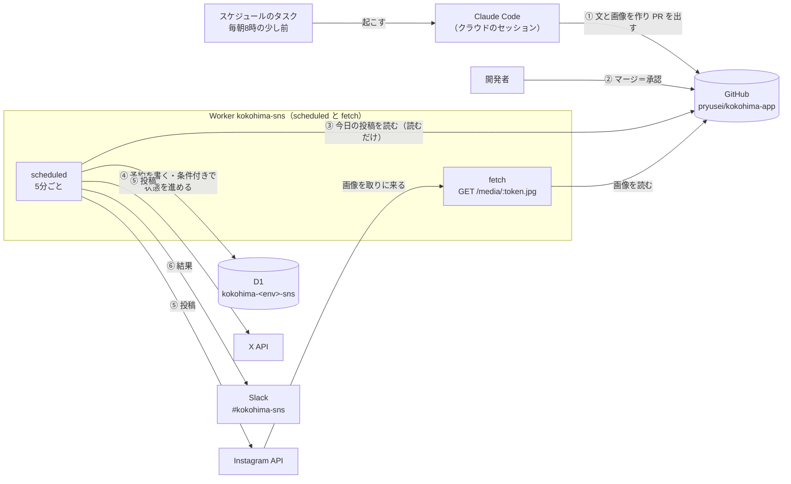
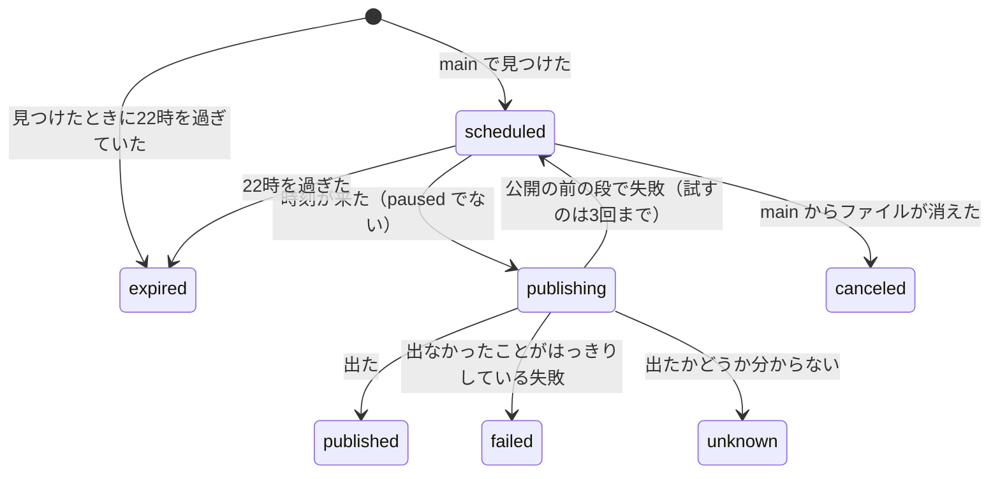

# T-30 仕様書：公式のXとInstagram

- 状態：下書き
- タスク票：docs/tasks/T-30-official-sns.md
- 関係する要件：NF-01、NF-03、NF-04、NF-05、セキュリティ設計（開発・運営アカウントの保護、外に出ている窓口、ログに秘密情報を出さない）、概要の「広告は入れない」

## 概要
ここ暇の公式アカウントを X と Instagram に置き、毎日の投稿を自動で回す。案（文と画像）は Claude Code が毎朝作って PR にする。開発者がマージすると予約になり、予約の時刻に専用の Worker（`kokohima-sns`）が各 API で投稿する。開発者の毎日の作業は、PR を見てマージすることだけにする。
アカウントの作成と開発者の登録は、規約で自動化できないので、最初に1回だけ人が行う（「人が行う準備」）。

## 決めたこと
1. **公開の承認は PR のマージ**（利用者の回答）。Worker が読むのは `main` だけで、`main` に入っていない投稿は出ない。Claude Code は案の PR を作るが、マージはしない。
2. **案は毎日その日の分を作る**（利用者の回答）。毎朝8時の少し前（JST）に、Claude Code のスケジュールのタスクがクラウドのセッションを起こし、その日の投稿の案の PR を1つ作る（「Claude Code での操作」）。
3. **予約の時刻を過ぎてからマージされた投稿は、その日の22時（JST）まではすぐ出し、22時を過ぎたら出さない。** 古い話題を夜中や翌日に出さないため。22時から翌朝8時までは何も出さない。
4. **投稿は専用の Worker（`apps/sns`、`kokohima-sns`）が出す。** アプリの Worker（`kokohima-api`）には入れない。理由：X・Instagram・GitHub のトークンをアプリの Worker に持たせない、SNS の失敗をアプリに波及させない、SNS の Worker からアプリの利用者のデータに届かないようにする（アプリの D1・KV・R2 のバインディングを持たせない）。D1 も専用（`kokohima-<env>-sns`）にする。
5. **投稿の中身はリポジトリのファイル（`marketing/posts/`）が正。** Worker は5分ごとに GitHub の API で `main` から今日の分を読む（読むだけのトークン）。投稿を受け付ける API は作らない（書き込みの窓口を外に出さない）。マージのたびにデプロイしない。
6. **Outbox と Queues は使わない。** API のハンドラから外部を呼ぶのではなく、Cron（scheduled）の中で1件ずつ出す。1日数件のため。二重に出さないことは、D1 の条件付きの UPDATE で守る（NF-03）。
7. **X の本文に URL を入れない。** 調べた料金（「API で調べたこと」）では、URL を含む投稿は普通の投稿の10倍以上かかる。アプリの URL はプロフィールに置く。Instagram はキャプションのリンクを押せないので、こちらもプロフィールに置く。
8. **画像は Claude Code がテンプレートから作る。** `marketing/templates/` の HTML を Playwright で JPEG に書き出し、リポジトリに入れる。写真のような人物の画像は作らない（実在の人と取り違えられるため）。アプリの画面を載せるときは、E2E の偽のデータで撮ったものだけを使う。
9. **公開の窓口は、Instagram に画像を渡す経路だけ**（`GET https://sns.kokohima.app/media/<token>.jpg`）。Instagram の API は画像を公開の URL から取りに来るため。投稿を出している間だけ開き、それ以外は404にする。
10. **Instagram のトークンは D1 に暗号化して持ち、Worker が自分で更新する。** 長期のトークンは60日で切れ、更新すると新しいトークンになるので、wrangler secret には置けない（Worker が secret を書き換えられない）。最初の1つだけ secret（`INSTAGRAM_SEED_TOKEN`）で渡す。暗号化はカレンダーと同じ形（kid つきの AES-GCM。T-06）にする（NF-04）。
11. **X は OAuth 1.0a（ユーザーのコンテキスト）で出す。** 公式アカウントで作ったアプリの Access Token と Secret は期限がないので、更新の仕組みが要らない。
12. **投稿にアプリの利用者のデータを使わない。** 人数・成立数・エリアの分布も出さない（NF-08 の集計の方法がまだ決まっていない。#46）。機能の紹介は、`docs/specs/` で「実装済み」になっている機能だけにする。
13. **広告・アフィリエイト・ほかのサービスとのタイアップの投稿はしない**（概要の「広告は入れない」）。

## 構成



- ① 案の PR は `marketing/` の下だけを変える。CI がファイルを検査する（「投稿のファイル」）。
- ③ 今日（JST）の月のフォルダの一覧を読み、ファイル名が今日の日付で始まるものだけを見る。
- ⑤ X は画像をアップロードしてから投稿する。Instagram は画像の URL を渡して入れ物（コンテナ）を作り、できあがったら公開する。
- アプリの Worker・D1・利用者には何もつながない。

## 人が行う準備
手順の詳しいことは、実装PRで `docs/runbooks/sns.md` に書く。ここでは何を誰が行うかを決める。

1. **連絡用のアドレス**：`sns@kokohima.app` を Cloudflare のメールの転送で開発者のアドレスに届ける。両方のアカウントの登録と復旧に使い、個人のアドレスを使わない。
2. **X**：
   - アカウントを作る（ハンドルは確認事項2）。表示名「ここ暇」、プロフィールに `https://kokohima.app`。パスキーか認証アプリの2段階認証。
   - 開発者のコンソールで、公式アカウントのまま開発者の登録をし、アプリを作る。権限を「Read and Write」にしてから、Consumer Key・Secret と Access Token・Secret を発行する（権限を変えたら発行し直す）。
   - 料金：使った分だけ払う形（「API で調べたこと」）。クレジットを入れ、使える上限を設定する。
3. **Instagram**：
   - アカウントを作り、プロアカウント（ビジネス）に切り替える。プロフィールに `https://kokohima.app`。2段階認証。
   - Meta for Developers でアプリを作り、「Instagram ログインによる Instagram API」を加える。公式アカウントをアプリのテスターにして、Instagram の設定で招待を受ける。アプリのダッシュボードで長期のトークンを発行する。
   - 自分のアカウントにだけ出すので、アプリの審査は受けない前提（確認事項1）。
4. **GitHub**：
   - fine-grained の個人のアクセストークンを作る。対象は `pryusei/kokohima-app` だけ、権限は Contents の読み取り（Metadata の読み取りは自動で付く）だけ、期限は1年。
   - `main` のブランチ保護で、直接の push を禁じ、CI（`ci`・`e2e`）の成功を必須にする（今の設定のままなら確かめるだけ）。
5. **Slack**：運営者だけが入る非公開のチャンネル `#kokohima-sns` を作り、Incoming Webhook の URL を発行する。
6. **Cloudflare**：`terraform apply`（D1）、`wrangler d1 migrations apply`、`wrangler secret put`（「設定値」の secret）、`pnpm --filter sns deploy:prod`。
7. **Claude Code**：スケジュールのタスクを作る（「Claude Code での操作」。開発者が頼めば Claude Code が作る）。

## API で調べたこと
2026-11-23 に Web の検索で調べた。公式の資料（docs.x.com・developers.facebook.com）は、この作業環境から開けず読めていない。実装の最初に公式の資料で確かめ、違えばこの仕様書を直す（確認事項1）。

- **X**
  - 料金は使った分だけ払う形（従量）で、新しい開発者の無料の枠はない（登録の特典のクレジットがあるという記事はある）。投稿は1件 約 $0.015、URL を含む投稿は1件 約 $0.20。値段は2026年の間にも変わっている。
  - 投稿：`POST https://api.x.com/2/tweets`（`text`、`media.media_ids`）。画像：`POST https://api.x.com/2/media/upload`。
  - 本文は重みつきで280まで（日本語の文字は2、URL は23と数える）。画像は4枚まで。
- **Instagram**
  - プロアカウント（ビジネス・クリエイター）だけ。「Instagram ログイン」の形なら Facebook のページは要らない。料金はかからない。
  - 権限：`instagram_business_basic`、`instagram_business_content_publish`。
  - 投稿：`POST https://graph.instagram.com/<版>/<IGのID>/media`（`image_url`・`caption`。カルーセルは子のコンテナを作ってから `media_type=CAROUSEL` と `children`）→ `GET /<コンテナのID>?fields=status_code` が `FINISHED` になるのを待つ → `POST /<IGのID>/media_publish`（`creation_id`）。
  - 1つのアカウントで24時間に100件まで（カルーセルは1件）。コンテナは24時間で切れる。画像は JPEG だけ、8MB まで、縦横の比は 4:5 から 1.91:1。
  - 長期のトークンは60日。発行から24時間たったあと、切れる前に `GET https://graph.instagram.com/refresh_access_token?grant_type=ig_refresh_token&access_token=…` で更新でき、新しい60日のトークンになる。

## 投稿のファイル
- 置き場所：`marketing/posts/<YYYY-MM>/<DD>-<slug>.yaml`（例：`marketing/posts/2026-12/01-lunch.yaml`）。`slug` は英小文字・数字・`-` の40文字まで。
- 投稿の ID：`<YYYY-MM>/<DD>-<slug>`（パスから決まる。ファイルの中に書かない）。
- 画像：`marketing/images/<YYYY-MM>/<名前>.jpg`。
- 形（Zod のスキーマ `snsPostSchema`。`packages/shared/src/schemas/snsPost.ts`。CI の検査と Worker で同じものを使う）：

```yaml
publishAt: 2026-12-01T12:00+09:00   # JST の時差を必ず書く。分は5の倍数
x:                                   # なければ X には出さない
  text: |
    「今夜ひま？」って聞くの、ちょっと勇気いりますよね。
    ここ暇は、ひまな時間を置いておくだけ。
  images:                            # 0〜4枚
    - marketing/images/2026-12/01-lunch.jpg
instagram:                           # なければ Instagram には出さない
  caption: |
    ...
  images:                            # 1〜10枚。2枚以上はカルーセル
    - marketing/images/2026-12/01-lunch.jpg
```

- 検査（`snsPostSchema` と、リポジトリを見る検査のスクリプト）
  - `x` と `instagram` の少なくとも1つがある。知らない項目は拒否（strict）。
  - `publishAt`：時差つきの ISO 8601。JST の日付がパスの `<YYYY-MM>/<DD>` と同じ。JST の 08:00〜21:55。分は5の倍数。ファイルの中だけ JST の時差で書く（人が読み書きするため。`api-conventions` の「API の日時は UTC」は API の決まりで、ここは API ではない）。
  - `x.text`：前後の空白を除いて空でない。X の重みつきの数え方で280まで（下の「文字の数え方」）。URL（`http://`・`https://`・`www.`・ドメインの形の文字列）を含まない（決めたこと7）。メンション（`@`）を含まない（ほかのアカウントに知らせない）。ハッシュタグは2つまで。
  - `instagram.caption`：空でない、2200文字まで、ハッシュタグは5つまで、メンションを含まない。
  - 見えない文字・制御文字（改行とタブを除く）を拒否。
  - `images`：`marketing/images/` の下の、実在する `.jpg`。中身が JPEG（先頭が `FF D8 FF`）、2MB まで。大きさは、X が 1080×1350・1080×1080・1200×675、Instagram が 1080×1350・1080×1080 のどれか。Instagram のカルーセルは全部の画像を同じ大きさにする。
  - 1日の数：同じ日のフォルダの中で、X は3件まで、Instagram は1件まで。
  - PR で足した・変えた投稿のファイルは、`publishAt` の日付が今日（JST）以降（過去の日付のファイルは、出ないのに残るので入れない）。
- 文字の数え方（X）：公開されている twitter-text の第3版の数え方。Unicode の決まった範囲（`0-4351`・`8192-8205`・`8208-8223`・`8242-8247`）の文字は1、それ以外は2、絵文字は2。上の検査で URL は入らないので、URL を23と数える処理は持たない。domain の純粋な関数にする。
- 止める：`marketing/sns.yaml` の `paused: true`（`snsConfigSchema`）。マージすると、まだ出ていない投稿は出ない（下の「振る舞い」）。`false` に戻すと、その日の22時までの分は出る。

## API
`api-conventions` に従う。公開する経路はこの1つだけ（決めたこと9）。ほかのパス・メソッドはすべて404。

| メソッド | パス | 認証 | 入力 | 出力 | 主なエラー |
| --- | --- | --- | --- | --- | --- |
| GET・HEAD | `https://sns.kokohima.app/media/<token>.jpg` | なし（`token` を知っていること） | `token`：base64url の43文字（32バイトの乱数） | 200：JPEG の本文 | 404（形が違う・ない・期限切れ・出している最中でない。どれも同じ本文） |

- `api-conventions` の `/api/v1/` の外に置く例外：Instagram に渡す画像の URL で、アプリの API ではないため。
- 応答のヘッダー：`Content-Type: image/jpeg`、`Cache-Control: no-store`、`X-Content-Type-Options: nosniff`、`Content-Security-Policy: default-src 'none'`。
- 404 は本文なし（problem+json にしない。どの理由でも同じ形）。
- 画像は GitHub から blob の sha で読み、先頭が JPEG でなければ404にする。

## データ
D1 `kokohima-<env>-sns`（アプリの D1 とは別）。マイグレーションは `apps/sns/migrations/0001_init.sql`。日時は Unix ミリ秒。利用者の個人の情報は持たない。

### `sns_publications`（投稿とチャンネルごとに1行）
- 列：`post_id`（TEXT）、`channel`（`x`・`instagram`）、`status`、`publish_at`、`deadline_at`（その日の 22:00 JST）、`content_sha`（投稿のファイルの blob の sha）、`step`（Instagram の途中：`container_created`。null可）、`container_id`（null可）、`remote_id`（null可）、`remote_url`（null可）、`attempts`（既定0）、`next_attempt_at`（null可）、`error_kind`（null可。種類だけ）、`created_at`、`updated_at`、`published_at`（null可）
- 主キー：`(post_id, channel)`。インデックス：`(status, next_attempt_at)`。
- 状態の遷移（すべて `WHERE status = ?` の条件付きの UPDATE。domain の関数で遷移を決める）：



- `failed`・`unknown`・`published`・`canceled`・`expired` から先には進まない（人が確かめる）。
- 保持：消さない（個人の情報がなく、1日数行のため）。

### `sns_media_tokens`
- 列：`token`（TEXT PK）、`post_id`、`channel`、`blob_sha`、`expires_at`（作ってから60分）
- 経路の `GET` は、`token` が一致し、`expires_at > now` で、同じ `(post_id, channel)` の `sns_publications.status` が `publishing` のときだけ画像を返す。
- 投稿が `published`・`failed`・`unknown` になったら、その投稿の行を消す。期限切れの行は毎回の Cron で消す。

### `sns_tokens`（Instagram のトークン）
- 列：`name`（TEXT PK。`instagram`）、`ciphertext`、`kid`、`seed_hash`（`INSTAGRAM_SEED_TOKEN` の SHA-256）、`issued_at`、`refreshed_at`、`expires_at`、`last_refresh_error_at`（null可）
- 平文のトークンは D1 にもログにも書かない。

### `sns_sync`
- 列：`path`（TEXT PK。読んだフォルダ）、`etag`、`synced_at`。GitHub の条件つきの読み取り（`If-None-Match`）に使う。

## 振る舞い

### 毎回の Cron（5分ごと）
次の順に行う。1つが失敗しても、ほかは続ける。

1. **設定を読む**：`main` の `marketing/sns.yaml`。読めないときは、前回の値を使う（初めてで読めなければ `paused: true` として扱う）。
2. **今日の投稿を読む（同期）**：`GET /repos/<repo>/contents/marketing/posts/<YYYY-MM>?ref=main`（`If-None-Match`）。名前が今日の `<DD>-` で始まるファイルを見る。
   - 新しいファイル：blob を読み、`snsPostSchema` を通す。通らなければ Slack に出して行を作らない（CI を通っているので、起きたら仕組みの不具合）。通れば、チャンネルごとに行を作る（`INSERT OR IGNORE`）。`publish_at` が過ぎていても `deadline_at` の前なら `scheduled`、過ぎていれば `expired`（Slack に1回だけ出す）。
   - sha が変わったファイル：`scheduled` の行だけ、`content_sha` と `publish_at` を書き換える（チャンネルが消えた行は `canceled`、増えたチャンネルは新しい行）。`publishing` 以降の行は変えず、Slack に「出したあとのため反映しません」を1回だけ出す。
   - 一覧から消えたファイル：`scheduled` の行を `canceled` にする。
   - 304 なら何もしない。
3. **22時を過ぎた予約を `expired` にする**：`status = 'scheduled' AND deadline_at <= now`。Slack に出す。
4. **出す**：`status = 'scheduled' AND publish_at <= now AND (next_attempt_at IS NULL OR next_attempt_at <= now)` の行を、`publish_at` の古い順に1回に5件まで。`paused` なら出さず、Slack に「止めています」を投稿ごとに1回だけ出す（22時を過ぎれば3.で `expired`）。
5. **Instagram の途中の行を進める**：`status = 'publishing' AND step = 'container_created'` の行（「Instagram に出す」の3.から）。
6. **Instagram のトークンの更新**（下の「トークン」）。
7. **期限切れの画像のトークンを消す**。
8. **GitHub のトークンの期限を確かめる**：応答のヘッダー `github-authentication-token-expiration` を見て、残り30・14・7・1日で Slack に出す（1日1回まで）。

- 同じ時刻に Cron が重なっても、状態を進めるのは条件付きの UPDATE で1つだけになる。`scheduled → publishing` の UPDATE で1行変わったときだけ、その投稿を出す。
- `publishing` のまま30分を過ぎた行（Worker が途中で止まったなど）は、`step` が `null` なら `unknown`、`container_created` なら5.で続きから進める。

### X に出す
1. `scheduled → publishing`（`attempts` を1増やす）。
2. 投稿のファイルを `content_sha` の blob で読み、`snsPostSchema` をもう一度通す。
3. 画像を1枚ずつ GitHub から読み、JPEG を確かめて `POST /2/media/upload` に送る。
4. `POST /2/tweets`（`text`、画像があれば `media.media_ids`）。
5. 結果：
   - 201：`published`。`remote_id`、`remote_url`（`https://x.com/<X_HANDLE>/status/<id>`）。Slack に URL。
   - 1〜3 の失敗（GitHub・画像のアップロードの失敗。まだ何も公開されていない）：`attempts < 3` なら `scheduled` に戻し、`next_attempt_at` を5分・15分後にする。3回めなら `failed`。
   - 4 の 400・401・403（重複の投稿を含む）：`failed`。
   - 4 の 429：`scheduled` に戻す（`x-rate-limit-reset` の時刻か15分後の遅い方。回数は上と同じ）。
   - 4 の 5xx・時間切れ（30秒）・通信の失敗：`unknown`。出たかどうか分からないので、もう一度は送らない（2回出るのを防ぐ）。Slack に「出たかどうか分かりません。アカウントを確かめてください」。

### Instagram に出す
1. `scheduled → publishing`（`attempts` を1増やす）。投稿のファイルを読み、`snsPostSchema` をもう一度通す。
2. 画像ごとに `sns_media_tokens` を作り、`image_url` を `https://sns.kokohima.app/media/<token>.jpg` にしてコンテナを作る。1枚なら `image_url` と `caption`。2枚以上なら子のコンテナ（`is_carousel_item=true`）を作ってから、`media_type=CAROUSEL`・`children`・`caption` の親のコンテナ。親のコンテナの ID を `container_id`、`step = 'container_created'` にする（条件付きの UPDATE）。
3. `GET /<container_id>?fields=status_code` を5秒おきに30秒まで見る。`FINISHED` なら4.へ。`IN_PROGRESS` のままなら、この回は終え、次の Cron で3.から続ける。`ERROR`・`EXPIRED`、または作ってから30分を過ぎたら、公開の前の失敗として扱う。
4. `POST /<INSTAGRAM_USER_ID>/media_publish`（`creation_id`）→ 200 なら `published`。`GET /<メディアのID>?fields=permalink` で `remote_url`。Slack に URL。
5. 結果：
   - 1〜3 の失敗（まだ公開されていない）：`attempts < 3` なら `step`・`container_id` を空にして `scheduled` に戻す（5分・15分後）。3回めなら `failed`。
   - 4 の 400・401・403：`failed`。4 の 429・5xx・時間切れ・通信の失敗：`unknown`（X と同じ理由）。
   - 終わったら、その投稿の `sns_media_tokens` を消す。

### トークン（Instagram）
- 使うとき：`sns_tokens` の行を `SNS_TOKEN_KEYS` で復号する。行がない、または `INSTAGRAM_SEED_TOKEN` の SHA-256 が `seed_hash` と違うとき（開発者が新しいトークンを入れたとき）は、secret の値を暗号化して行を作り直す（`issued_at` は今、`expires_at` は今＋60日）。
- 更新：毎回の Cron で、`refreshed_at`（なければ `issued_at`）から7日たっていて、`issued_at` から24時間たっていれば `refresh_access_token` を呼ぶ。成功したら新しいトークンを暗号化して書き換え、`expires_at` を応答の `expires_in` から決める。失敗したら `last_refresh_error_at` を書き、Slack に出す（1日1回まで）。
- 残り10日を切ったら、毎日 Slack に「Instagram のトークンが切れそうです」と手順書のパス（`docs/runbooks/sns.md`）を出す。切れたら Instagram の行は `failed`（`error_kind: token_expired`）。
- 鍵の入れ替え：`SNS_TOKEN_KEYS` に新しい kid を足して `SNS_TOKEN_CURRENT_KID` を変えると、次の更新で新しい鍵で書き換わる（T-06 と同じ考え方）。

### Slack への知らせ
- 届けるもの：公開した（チャンネル・投稿の ID・URL）、出さなかった（`expired`・`canceled`・`paused`）、失敗（`failed`・`unknown` と `error_kind`）、トークンの期限（Instagram・GitHub）、投稿のファイルの不具合。
- 文の組み立ては domain の純粋な関数。`&`・`<`・`>` をエスケープする（T-24 と同じ）。トークン・Webhook の URL・API の応答の本文を入れない。
- `SNS_SLACK_WEBHOOK_URL` がないとき（staging・ローカル）は送らず、ログだけにする。Slack への送信の失敗は、投稿の状態を変えない（ログだけ）。

### 空撃ち（`SNS_DRY_RUN=1`）
- staging とローカルで使う。同期・状態の遷移・画像のトークンは本物と同じに動かし、X・Instagram の API の呼び出しだけを、偽の結果（`remote_id: dry-run-…`）を返す関数に差し替える。`api.x.com`・`graph.instagram.com` には1回も fetch しない。
- prod の設定に `SNS_DRY_RUN` がないこと、staging は `"1"` であることを、本番のビルドの検査（`apps/sns/scripts/check-wrangler-config.mjs`）で確かめる。

### ログ
- `sns_sync`（読んだファイルの数・変わった数）、`sns_publish`（投稿の ID・チャンネル・結果・`error_kind`・状態コード）、`sns_token_refresh`（結果）。
- 出さないもの：トークン・Webhook の URL・API の応答の本文・リクエストのヘッダー・画像の URL（`token` を含むため）。投稿の本文も出さない（公開の内容だが、ログには要らない）。
- `observability.issues` を有効にし、T-13 と同じく Workers Issues から Slack に送る。

### 構成（コード）
- `apps/sns/src/{domain,application,infra}`（CLAUDE.md の構成に合わせる。contexts は `sns` の1つ）。
  - `domain/`：状態の遷移、予約の判断（期限・時刻・止める）、X の文字の数え方、Slack の文、OAuth 1.0a の署名の文字列の組み立て（鍵での署名は infra）。
  - `infra/`：GitHub・X・Instagram・Slack の呼び出し（`deps.fetch` で差し替えられるように）、D1 の文、暗号化。
- `yaml` の読み取りは infra（GitHub から読んだあと）で行い、domain には検査の済んだ値を渡す。
- 単体テストは Workers のランタイムの上で動かす（`@cloudflare/vitest-pool-workers`。api と同じ）。

## Claude Code での操作

### 毎朝の案（スケジュールのタスク）
- Claude Code のスケジュールのタスク（claude.ai のクラウドの、発火のたびに新しいセッションを作る形）。このリポジトリで、毎日 JST の8時の少し前に起こす。終わったらスマートフォンに知らせる。
- 作るのは、Worker のデプロイと両方のアカウントの準備が済んでから（「人が行う準備」の7.）。
- セッションが行うこと（`sns-posting` スキルに書く）：
  1. 前日までに開いたままの「SNS：」の PR を閉じる（出ないまま残るため）。
  2. その日の分を作る：X は1件（既定 12:00）、Instagram は月曜と木曜に1件（既定 20:00）。
  3. 画像が要れば、テンプレートから書き出す（`pnpm --filter sns render <ファイル>`）。
  4. 検査を通す（`pnpm --filter sns check:posts`）。
  5. `marketing/` の下だけを変えた PR を、「SNS：<YYYY-MM-DD> の投稿」の題で作る。下書きの PR にしない（マージの1タップで済むように）。本文に、各投稿の時刻・チャンネル・本文をそのまま載せる（スマートフォンで画像と一緒に読めるように）。
  6. マージはしない（決めたこと1）。
- セッションは Web を見に行かない。材料は、このリポジトリ（仕様書・要求定義書・今までの投稿）だけにする（Web のページにある指示に引っぱられないため）。

### 頼まれたときの操作
- 「来週の金曜にお知らせを出して」：その日付のフォルダにファイルを足す PR。
- 「今日のを取り消して」：ファイルを消す PR（出る前にマージすれば出ない）。
- 「止めて」：`marketing/sns.yaml` を `paused: true` にする PR。急ぐときは、開発者が GitHub の画面でこのファイルを直接書き換えてもよい（`main` の保護を一時的に外すか、管理者として通す）。
- 出したあとの投稿を消すのは、各アプリで人が行う（スコープ外）。

### スキル（`.claude/skills/sns-posting/SKILL.md`）
実装PRで書く。中身：
- 投稿のファイルの形と検査のコマンド、画像の書き出し、PR の作り方（上の6つの手順）。
- 声の調子：やわらかく、押しつけない。誘う気まずさに寄りそう。画面の言葉は `invitation-domain` スキルの用語表に合わせる（「ここ暇」「誘い」「募集」「今回は難しい」など）。
- 書くもの：使い方のヒント、誘うときの「あるある」、実装済みの機能の紹介、お知らせ（新しい機能・止まったときなど）。同じ話題を2週間のうちにくり返さない（今までの投稿を読んで確かめる）。
- 書かないもの：決めたこと12・13、まだ作っていない機能の約束、ほかのサービスの悪口、政治・災害・事件・健康・お金の話題、実在の人の名前、ほかのアカウントへのメンション、天気や交通など外の事実（調べないので確かめられない）、エンゲージメントをあおる文（「いいねで〜」）。
- 断り・期限切れ・キャンセルを悪いことのように書かない（CLAUDE.md の UI の決まりと同じ考え方）。

### 画像のテンプレート
- `marketing/templates/<名前>.html`。色は `apps/web/src/index.css` のトークンと同じ値を使う。フォントは、リポジトリに入れた Noto Sans JP（SIL Open Font License。ライセンスの文も入れる）を `@font-face` で読み、環境のフォントに頼らない（セッションごとに見た目が変わらないように）。
- 書き出し：`apps/sns/scripts/render.mjs`。Playwright の Chromium で、決まった大きさ（1080×1350 など）・`deviceScaleFactor: 1`・JPEG（品質85）。テンプレートには外のサイトを読ませない（オフラインで書き出す。`page.route` で外への要求を止める）。

## CI
- `pnpm test` に、`marketing/posts/` のすべてのファイルを `snsPostSchema` と画像の検査に通すテストを入れる（今の `ci` の `unit` のジョブで動く）。
- PR で足した・変えた投稿のファイルの日付の検査（「投稿のファイル」）は、`pnpm --filter sns check:posts --changed origin/main` で行い、`ci` の `unit` のジョブに足す（PR のときだけ）。
- `e2e` のジョブ：変わったファイルが `marketing/` の下だけなら、手順を飛ばしてジョブを成功にする。`paths-ignore` は使わない（必須のチェックが「待っている」のまま残り、マージできなくなるため）。
- `require-unit-tests`（`feat/*` だけ）は変えない。毎朝の PR は `feat/` のブランチにしない。

## 設定値（Workers・`apps/sns/wrangler.jsonc`）
| 名前 | 種類 | 内容 |
| --- | --- | --- |
| `X_API_KEY`・`X_API_SECRET` | secret | X のアプリの Consumer Key・Secret |
| `X_ACCESS_TOKEN`・`X_ACCESS_TOKEN_SECRET` | secret | 公式アカウントの Access Token・Secret（Read and Write） |
| `X_HANDLE` | vars | 公式アカウントのハンドル（`@` なし。URL を作るため） |
| `INSTAGRAM_SEED_TOKEN` | secret | Instagram の長期のトークン（最初の1つと、入れ直すとき。決めたこと10） |
| `INSTAGRAM_USER_ID` | vars | 公式アカウントの Instagram の ID |
| `INSTAGRAM_API_VERSION` | vars | Graph API の版（実装のときに公式で確かめた版） |
| `SNS_TOKEN_KEYS` | secret | トークンの暗号化の鍵（kid → 32バイトの base64 の JSON。T-06 と同じ形。アプリの鍵とは別に作る） |
| `SNS_TOKEN_CURRENT_KID` | vars | 暗号化に使う鍵ID |
| `GITHUB_CONTENT_TOKEN` | secret | fine-grained の個人のアクセストークン（このリポジトリの Contents の読み取りだけ） |
| `GITHUB_REPO`・`GITHUB_BRANCH` | vars | `pryusei/kokohima-app`・`main` |
| `MEDIA_ORIGIN` | vars | `https://sns.kokohima.app` |
| `SNS_SLACK_WEBHOOK_URL` | secret | `#kokohima-sns` の Incoming Webhook（なければ送らない） |
| `SNS_DRY_RUN` | vars | `"1"` で X・Instagram を呼ばない（staging・ローカル。prod には置かない） |

- 必須の値がない・形が違うときは、その回の Cron で投稿を出さず、ログ `sns_config_invalid`（どの名前か。値は出さない）だけを出す。
- バインディングは `DB`（`kokohima-<env>-sns`）だけ。Queues・KV・R2・アプリの D1 は持たない（検査のスクリプトで確かめる）。
- Cron：`*/5 * * * *`。
- prod の `routes`：`sns.kokohima.app`（`custom_domain: true`）。`workers_dev`・`preview_urls` は `false`。staging は `routes` を持たない（空撃ちで Instagram が画像を取りに来ないため）。

## インフラ（`infra/terraform`）
- `cloudflare_d1_database.sns`：`kokohima-${var.env}-sns`、`prevent_destroy`。staging と prod。
- `sns.kokohima.app` の DNS の記録は、Workers のカスタムドメインが作るので Terraform では作らない（T-12 の `kokohima.app` と同じ扱い）。
- `sns@kokohima.app` の転送：今のメールの転送の管理の場所に合わせる（実装PRで確かめる）。

## 認可と秘匿
- 閲覧者IDの使い方：利用者のデータを扱わない。SNS の Worker には利用者がいない。
- 他人のデータに届かないことの保証：SNS の Worker は、アプリの D1・KV・R2 にバインディングを持たない（決めたこと4。wrangler の設定の検査とテストで確かめる）。毎朝のセッションは本番のデータに届く資格情報を持たず、材料はリポジトリだけ（「毎朝の案」）。
- 区別させない応答：画像の経路の404は、どの理由でも同じ形（`token` があるか・期限切れか・出している最中かを区別させない）。
- 公開の権限：`main` にマージできる人だけが投稿を出せる。ブランチ保護で直接の push を禁じる。Claude Code はマージしない。
- 秘密情報：すべて SNS の Worker の wrangler secret。アプリの Worker・GitHub の Actions・リポジトリには置かない。Instagram のトークンは D1 に暗号化して置く（NF-04）。
- アカウントの保護：X・Instagram・Meta for Developers・X の開発者のコンソールを、要求定義書の「開発・運営アカウントの保護」に足す（パスキーか認証アプリ。登録のアドレスは `sns@kokohima.app`）。
- 漏れたとき：X のトークンは開発者のコンソールで発行し直す。Instagram はアプリのダッシュボードでトークンを無効にし、新しいものを `INSTAGRAM_SEED_TOKEN` に入れる。GitHub のトークンは消して作り直す（読めるのはこのリポジトリのファイルだけ）。手順書に書く。
- 受け入れるリスク：
  - マージした案に誤りがあると、そのまま出る（人の確認を1回通すことで受け入れる）。出たあとは各アプリで消す。
  - GitHub のトークンが漏れると、このリポジトリのソースコードが読まれる（秘密情報はリポジトリにないので、書き込み・投稿はできない）。
  - 画像の URL は出している間（最長60分）は誰でも開ける。中身はこれから公開する画像なので受け入れる。
  - `unknown` の投稿は、出ていないこともある。2回出るより出ないほうを選ぶ。

## テスト計画

### 単体テスト（実装PRで必須）
- [ ] 正常系：今日のファイルを見つけて `scheduled` の行ができ、時刻が来ると X に画像つきで1回出て `published`・`remote_url`・Slack の文になる（偽の GitHub・X・Slack）
- [ ] 正常系：Instagram の1枚・カルーセル（子のコンテナ → 親 → `FINISHED` を待つ → 公開）。`IN_PROGRESS` のままなら次の回に続きから進む
- [ ] 入力検証（`snsPostSchema`）：チャンネルなし、知らない項目、時差なしの `publishAt`、パスと日付の食い違い、8時前・22時以降、5の倍数でない分、X の280の超過（日本語140文字は通り141文字は落ちる、英数字との混在）、URL・`www.`・ドメインの形・メンション・ハッシュタグの数、Instagram の2200文字、見えない文字、画像の枚数・拡張子・JPEG でない中身・大きさ・2MB の超過・カルーセルの大きさの違い、1日の件数
- [ ] 境界値・期限：22時の前に見つけた過去の時刻の予約はすぐ出る、22時ちょうどからは `expired`、`paused` の間は出ずに22時で `expired`、`paused` を戻すと出る
- [ ] 二重に出さない：同じ行に2つの Cron が同時に `scheduled → publishing` を試すと、出すのは1つだけ
- [ ] 取り消し・変更：消えたファイルの `scheduled` は `canceled`、`publishing` は変わらない。sha が変わったら `scheduled` だけ書き換わり、公開済みは変わらず Slack に1回
- [ ] 失敗：X の画像のアップロードの失敗は再試行（3回めで `failed`）、投稿の 403 は `failed`、429 は再試行、5xx・時間切れは `unknown` で2回めを送らない。Instagram のコンテナの `ERROR` は再試行、`media_publish` の 5xx は `unknown`
- [ ] 30分を過ぎた `publishing`（`step` なし）は `unknown`
- [ ] 画像の経路：出している最中の `token` だけ200と JPEG、ほかの投稿の `token`・期限切れ・`published` のあと・形の違う `token`・ほかのパスは同じ形の404。応答のヘッダー
- [ ] 他人のデータに届かない：wrangler の設定の検査で、バインディングが `DB`（sns）だけ・prod に `SNS_DRY_RUN` がない・staging が `"1"`・`routes` が prod の `sns.kokohima.app` だけ
- [ ] 空撃ち：`SNS_DRY_RUN=1` で `api.x.com`・`graph.instagram.com` に fetch しない
- [ ] トークン：初めは seed から暗号化して行ができる、seed を変えると入れ直す、7日で更新、24時間の前は更新しない、更新の失敗で Slack（1日1回）、残り10日の知らせ、D1 に平文がない、kid の入れ替え
- [ ] OAuth 1.0a：公開されている例の値で、署名のもとの文字列と `Authorization` のヘッダーが一致する
- [ ] GitHub：304 で何もしない、トークンの期限のヘッダーで残り30日の知らせ、`sns.yaml` が読めないときは前回の値・初めてなら止める
- [ ] Slack の文：特殊文字のエスケープ、トークン・Webhook の URL・応答の本文が入らない。Webhook がないときは送らない
- [ ] ログ：トークン・画像の URL・応答の本文・投稿の本文が出ない
- [ ] 設定値：必須の値がないと投稿を出さず `sns_config_invalid`
- [ ] リポジトリの投稿：`marketing/posts/` のすべてのファイルが検査を通る（CI で動く）

### E2Eテスト（対象にする利用者の流れ）
- 対象なし。アプリの利用者の画面と流れを変えないため。投稿の流れは、偽の GitHub・X・Instagram の単体テストで確かめ、本物の API は人が staging（空撃ち）と prod の最初の投稿で確かめる（確認事項1）。

## 実装PRで直すもの
- docs/requirements.md：非機能の図に SNS の Worker（アプリの Worker と線でつながない）、技術選定に X API・Instagram API、セキュリティ設計の「開発・運営アカウントの保護」と「外に出ている窓口」に足す、悪用対策と運用に X の使える上限
- CLAUDE.md：アーキテクチャに `apps/sns`（専用の Worker）と `marketing/`、仕様書と PR の流れに「`marketing/` だけを変える毎日の SNS の PR はタスクでなく、仕様書の PR を要らない。承認はマージ」
- docs/runbooks/sns.md（新規）：人が行う準備の手順、プロフィールの文、トークンの入れ直し・漏れたとき・止め方
- .github/workflows/e2e.yml・ci.yml（「CI」）

## スコープ外
- アカウントの作成・開発者の登録・トークンの発行（人が行う）
- 返信・いいね・フォロー・DM・リポストの自動化（規約の上でも避ける）
- 反応の数の集計と、それを案に使うこと（次のタスク。X の読み取りの料金と、Claude Code のセッションから数を読む方法を決めてから）
- リール・ストーリーズ・動画・X のスレッドと引用
- 出したあとの投稿の削除・編集の自動化
- 利用者のデータを使う投稿（決めたこと12）、広告・タイアップ（決めたこと13）
- Web の話題（時事）を拾う案（Web を見に行かないため）

## 確認事項（合意前に解消する）
1. **API の公式の確認（未確認）**：「API で調べたこと」は Web の検索の結果で、公式の資料は読めていない。実装の最初に確かめる：X の料金（投稿・画像のアップロード・URL つき）と OAuth 1.0a で `/2/media/upload` を使えるか、Instagram の「自分のアカウントだけならアプリの審査が要らない」こと・権限の名前・カルーセルの枚数の上限・トークンの更新の条件。違えば仕様書を直す。
2. **ハンドル**：X と Instagram のアカウントの名前（案：`kokohima_app`）。空いているかは作るときに確かめる。
3. **頻度と時刻**：X は毎日1件 12:00、Instagram は月・木の 20:00 から始めてよいか。
4. **費用**：X は月30件で 約 $0.5 の見込み（画像のアップロードの料金は未確認）。使える上限をいくらにするか（案：月 $5）。毎朝の Claude Code のセッションは、開発者の Claude のプランの利用分を使う。
5. **案の PR を読む負担**：毎日 PR の本文に全文を載せる形でよいか。

## 変更履歴
| 日付 | 変更内容 | 理由 |
| --- | --- | --- |
| 2026-11-23 | 下書き | 公式の X と Instagram を、Claude Code で操作できる形で自動にしたい（利用者の依頼）。承認は PR のマージ、案は毎日その日の分（利用者の回答） |
